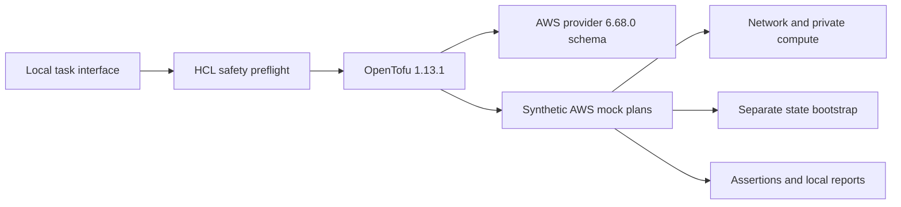

# Cloud foundation IaC

A local reference project for reviewing an AWS foundation with OpenTofu:
private networking, minimal compute/IAM and separate encrypted-state bootstrap
configuration. It runs the real engine and provider schema with synthetic
provider mocks. It creates no AWS resources and needs no AWS credentials.

**Status:** implementation and development checks passed on 2026-10-24. Formal
revision-bound local evidence, clean-clone verification, publication and hosted
CI are pending. See [validation](docs/validation.md) for results and limitations.
This is lab engineering work, not a production deployment or employment claim.

## What the core implements

| Component | Implementation | Demonstration |
| --- | --- | --- |
| Network | VPC, two derived private subnets, route tables and associations; separately disabled edge/Internet Gateway profile | Native mocked plans check ranges, placement, routing configuration and disabled defaults |
| Compute | Private `t3.micro`, encrypted gp3 root disk, IMDSv2, scoped security group and an EC2 trust role without workload permissions | Native mocked plans inspect configuration; the cloud-init fixture is not boot-tested |
| State bootstrap | Separate S3/KMS configuration, versioning, public-access blocks, named roles and environment-scoped state/lock permissions | Native mocked plans check state design; no S3 backend is active |
| Execution boundary | Parsed HCL preflight, explicit mock-only plan tests, restricted subprocess environment and blocked live tasks | Positive and negative guard tests |
| Quality gates | Pinned tools/providers, schema validation, lint, native tests, policy checks and secret scans | Required local and clean-clone gates; hosted CI is tracked separately |



The diagram shows the local execution path. AWS is the configuration target;
there is no connection from this workflow to an AWS account. The provider
registry is a public package service, separate from AWS APIs.

## Prerequisites and quickstart

Use an ordinary CPython **3.14.8**, Git and Make on macOS 13+ ARM64 or glibc Linux
AMD64/ARM64. Platform download pins exist for all three; their execution status
is recorded separately. Initial bootstrap needs HTTPS access to official public
release/package services. No Docker, hypervisor, root privilege, AWS CLI,
cloud credentials or paid service is required. Global packages are not changed.

From the root of this repository:

```sh
python3.14 --version
make bootstrap
make doctor
make lint
make test
make validate
make demo
make security
```

Bootstrap uses `python3.14` (override with `BOOTSTRAP_PYTHON=/path/to/python3.14`),
repairs a project virtual environment whose base interpreter was removed, and
installs the hash-pinned pip 26.2.2 certificate fix before package downloads.
It installs hash-checked tools into `.tools/` and Python packages into
`.venv/`; native provider initialization uses the committed lockfiles. Doctor
reports prerequisites. Tests must run real OpenTofu mocked plans, including
intentional invalid inputs, and reject missing or skipped cases. Validation
checks the configuration against the actual provider schema. The demo explains
and exercises this local contract; it never starts a server or creates a VM.

The documented command sequence is a release gate and is still awaiting the
formal clean-clone run. Any unexpected nonzero exit is a failure to investigate,
not a reason to remove a check. Expected invalid configurations are asserted
inside tests; the containing test command succeeds only when rejection occurs.

## Commands

| Target | Purpose |
| --- | --- |
| `make help` | List task descriptions |
| `make bootstrap` | Project-local dependency setup and locked provider initialization |
| `make doctor` | Prerequisites, pins and execution-boundary checks |
| `make lint` | Formatting and applicable language/workflow lint |
| `make test` | Guard/policy negative tests and actual native mocked plans |
| `make validate` | Native provider-schema validation and project checks |
| `make demo` | Bounded static/mock demonstration |
| `make security` | Secret scans of source, staged files and outgoing history |
| `make clean-clone` | Exercise the quickstart from an isolated temporary clone |
| `make record` / `make gate` | Produce and verify revision-bound local evidence |
| `make clean` | Report retained project-local caches; no cloud teardown or broad deletion |

`make plan`, `make apply`, `make destroy` and `make integration` are deliberately
blocked. The Python task interface exits 3 for these live-operation requests;
Make may return its own nonzero wrapper status. This is visible unsupported
behavior, never a skipped integration counted as a pass.

## Design and operating boundaries

Both root stacks default to zero resources. Mock tests explicitly enable
synthetic configurations to exercise real expressions and resource attributes.
Names, CIDRs, environment labels, zones and enabled-only identifiers are
validated. Fixtures contain unusable illustrative identifiers; they are not
recommended account IDs, AMIs or bucket names.

The private foundation has no NAT, public instance address, SSH key or managed
default route from private subnets. The optional edge profile adds distinct
subnets and an Internet Gateway without moving the workload. The health fixture
binds to `127.0.0.1:8080`; the reserved private security-group port does not make
it reachable from another host. A real boot would require a separately reviewed
x86_64 AMI with cloud-init, systemd and Python already installed.

The state stack describes a separate bucket and key. Its output proposes S3
locking coordinates; it does not configure a backend. Local backends remain
active. State, plan files, credentials, provider caches and private logs stay
out of Git. See [architecture](docs/architecture.md), the
[decision record](docs/decisions/0001-mock-only-foundation.md) and
[state operations](docs/runbooks/state-lifecycle.md).

## Security, cost and resources

The wrapper discards inherited credential settings, uses a project-owned empty
home and empty AWS configuration files, disables instance-metadata credential
lookup and restricts provider installation to the selected package identity.
Non-download commands receive a deliberately unreachable proxy as defense in
depth. These controls are **not an OS sandbox**; reviewed source and explicit
native mocks are essential. Running downloaded binaries directly bypasses the
task interface. See [SECURITY.md](SECURITY.md).

Provider installation currently warns that the upstream signing key is expired.
Native verification remains enabled; successful installation is not proof of a
current signing-key lifetime. This unresolved dependency limitation and the
observed registry/lock failures are recorded in
[dependency provenance](docs/dependencies.md).

Local checks create no billable AWS resources. A real enabled configuration
would incur compute, disk, KMS and storage/request charges; no free-tier promise
or budget-as-spending-cap claim is made. Allow roughly 2 CPUs, 2 GiB RAM and 3 GiB free
disk as an initial planning allowance, not a measured minimum or benchmark.
The provider archives alone are large. Run clone and native profiles
sequentially on small machines.

## Failure, recovery and teardown

Use [the walkthrough](docs/demo.md) to show safe input acceptance, invalid input
rejection and the blocked live-operation boundary. For tool/registry or lock
failures, follow [local checks](docs/runbooks/local-checks.md). Preserve the
failed output and code revision before fixing the cause; rerun the same gate.

No resource teardown is required for the supported demo. `make clean` retains
project caches and reports this choice; it does not delete cloud resources or
run global prune commands. Temporary clone cleanup is limited to that clone's
owned directory. Never treat a future real state file as disposable cache.

## What remains outside the result

There is no authenticated plan, apply, reachability test, EC2 boot, effective-IAM
test, S3 locking race test, cloud backup restore or cloud cost measurement.
Mocks prove configured behavior only. TFLint's bundled language rules are not
a complete cloud-security scanner; custom policies enforce only their documented
bounded checks. Terraform compatibility is unverified.

Load balancers, managed databases, Kubernetes, DNS, workload object storage,
audit logging, other clouds and real deployment remain separate gated
extensions. The cloud-init health fixture is not the container reference
application. Deploying a pinned release of that application belongs to a later,
explicitly authorized delivery profile. See [contribution guidance](CONTRIBUTING.md)
for how to extend the core with evidence.
