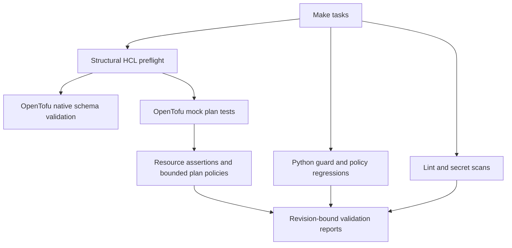
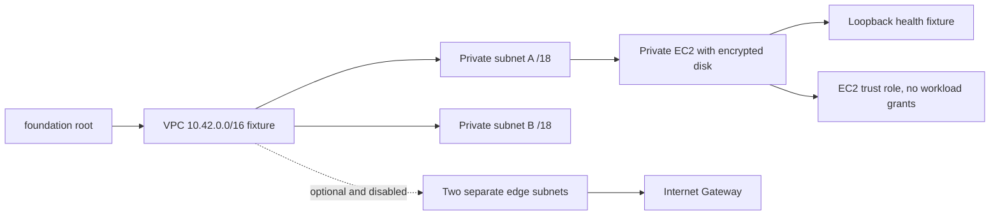
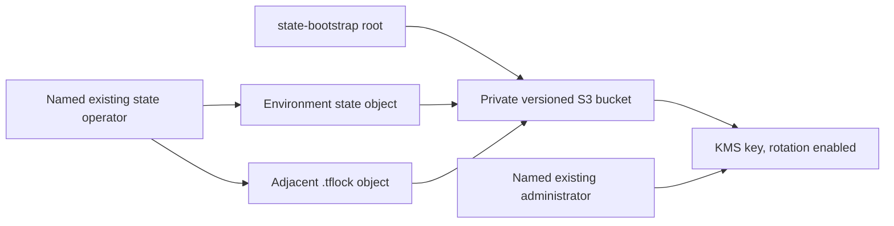

# Architecture

The runnable system is a local validation pipeline. The AWS diagrams below
describe configuration, not deployed resources. OpenTofu is the sole primary
engine; no emulator stands in for AWS.

## Local execution

`scripts/iac.py` constructs the subprocess environment and blocks live tasks.
`scripts/guard.py` parses source/tests before the engine sees them. It is a
bounded syntax/structure gate, not a full HCL evaluator. Native OpenTofu validates
provider schemas and evaluates the actual root/module expressions. Mock values
replace provider-computed attributes and all test runs are plan-only.

Tool and provider downloads use the public network. The provider source is
explicitly `registry.terraform.io/hashicorp/aws` at 6.68.0; this does not change
the engine to Terraform. Two root lockfiles preserve exact provider selection.
Local modules use relative paths inside the same standalone repository.

## Foundation configuration

The network divides a canonical private IPv4 range into four equal subnets.
The first two are private; the remaining two are reserved for the optional edge
profile. Two explicit distinct AZ names avoid discovery calls. Private route
tables have no managed default route; the AWS implicit VPC-local route remains.
Edge routing never attaches a public address or default route to the compute
subnet. There is no NAT, IPv6 or cross-VPC connectivity implementation.

Compute uses one `t3.micro`, standard CPU credits, an 8 GiB encrypted gp3 root
volume, required IMDSv2 and no SSH key or public address. Its security group has
one VPC-CIDR TCP 8080 ingress rule and no egress rules. The current service binds
loopback, so this port is reserved rather than reachable. A supplied AMI must
already include cloud-init, systemd and `/usr/bin/python3`. The template writes
a deterministic standard-library health service with `DynamicUser` and systemd
restrictions. This template has not been booted in a VM or EC2 instance here.

## State configuration

The state root is separate because its future bucket cannot store its own
initial state before it exists. It defines default SSE-KMS, bucket ownership,
public-access blocks and TLS denial. The identity policy permits only the
selected environment's state and adjacent lock object; deletion is reserved for
the lock. KMS use is tied to the exact key, S3 region and bucket encryption
context. Explicit named administrator/operator roles must preexist; the module
does not create their trust or all deployment permissions.

`lab` and `dev` produce distinct future state keys. Both roots currently use
local backends. Outputting S3 coordinates does not initialize a remote backend,
test concurrent locking or migrate state. The bootstrap stack's own state also
needs a separately protected lifecycle. The [runbook](runbooks/state-lifecycle.md)
describes these future requirements without executing them.

## Limits and extensions

The tests prove resource configuration and rejection behavior under synthetic
provider responses. They do not prove account availability, real IDs, image
compatibility, cloud-init boot, runtime networking, effective IAM, encryption
header enforcement, S3 concurrency or recovery. The AWS health fixture is not
the portfolio's asynchronous reference application. A later delivery extension
must pin that workload and demonstrate it separately.

Managed databases, load balancing, Kubernetes, DNS, application object storage,
audit logging, federated deployment identity and other clouds remain unstarted
extensions. Their cost, account scope and teardown require separate approval.
